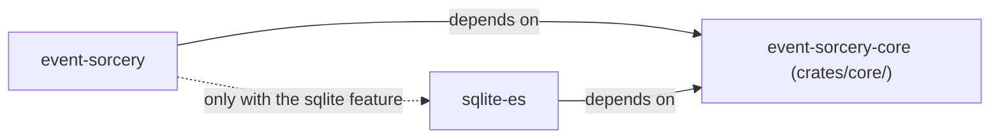

# 0016. Separate the persistence core from SQLite

- Status: Accepted
- Date: 2026-11-20
- Issue: [#122](https://github.com/dataclique/event-sorcery/issues/122)

## Context

`event-sorcery` can build without SQLite, but still owns SQLite SQL and
transaction code behind its `sqlite` feature. `sqlite-es` owns the SQLite schema
and repositories, yet cannot import the shared persistence logic it needs:
`event-sorcery` already depends on `sqlite-es`. Moving files to a module within
`event-sorcery` does not change that dependency direction.

Both backends must use the same commit validation and durable decisions. Native
Rust and FFI must continue to use one SQLite writer. The crate split must not
change stored data, migrations, or public constructor signatures.

## Decision

Extract backend-neutral persistence contracts and the shared behavior they
require into `event-sorcery-core` (`crates/core/`). Move SQLite storage into the
existing `sqlite-es` crate.

The diagram shows the split, not the unchanged callers. `postgr-es` uses
`event-sorcery` without SQLite; `event-sorcery-ffi` enables its `sqlite`
feature. Neither `sqlite-es` nor `event-sorcery-core` depends on
`event-sorcery`. The new crate contains the existing contract definitions and
decisions, not copies of them. Extract only what a storage implementation
consumes. Keep `Lifecycle`, CQRS execution, and worker hosting on the framework
side; pass prepared values or use the existing replay and decision boundaries
instead of exposing private types.

Move SQL and transaction ownership together into `sqlite-es`. Command events,
snapshot changes, and durable job intent (job event and queue row) must still
commit atomically. Native Rust and FFI delegate to the same writer; no
transaction crosses the C ABI. The public `event-sorcery` crate retains
reexports and inherent constructors such as `StoreBuilder::new(pool)`; those
constructors compose the SQLite adapter with the framework rather than
performing storage operations.

Start with the shared `CompactionPolicy`. Keep `compact_events::<Entity>(pool)`
and its result and error contract. The wrapper passes the aggregate type and
policy to `sqlite-es`, which owns the retention-window conversion and bounded
delete. Check per-stream windows, snapshot bounds, and rejection before deletion
when the window does not fit. Move the remaining persistence paths in slices
that preserve their tests and the native/FFI write boundary.

Verify default and PostgreSQL-only normal dependencies in isolated package
builds; workspace builds can enable SQLite through FFI and test dependencies.
Exercise the explicitly enabled SQLite constructors, real database tests, and
FFI conformance. No storage migration is needed; reverting a slice restores code
ownership without rolling back data.

## Alternatives considered

- **Group the SQLite code under one module in `event-sorcery`.** This cleans up
  names, but leaves SQLite persistence split between two crates and does not let
  `sqlite-es` consume shared decisions.
- **Make `sqlite-es` depend on `event-sorcery`.** This creates a dependency
  cycle unless `event-sorcery` drops its SQLite dependency, which would break
  the existing opt-in constructors and reexports.

## Consequences

`sqlite-es` gains a dependency on the shared persistence crate, not on the
framework or worker host. The public crate keeps its existing SQLite call sites
while no longer owning SQLite SQL or transaction execution. Shared contracts
must remain usable without either database driver.
