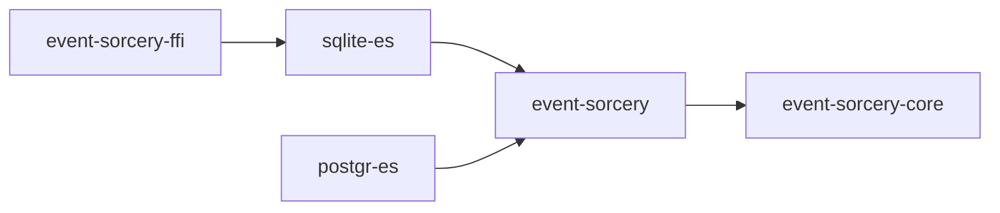

# 0016. Separate the framework from its storage adapters

- Status: Accepted
- Date: 2026-11-20
- Issue: [#122](https://github.com/dataclique/event-sorcery/issues/122)

## Context

[ADR-0012](0012-postgresql-repository-persistence.md) introduced atomic command
persistence on PostgreSQL. PostgreSQL also needs to build and recover native
stores and projections without linking SQLite. An optional SQLite dependency in
`event-sorcery` still makes the framework own SQLite constructors, concrete
errors, and startup wiring. Moving SQL alone does not fix that boundary.

## Decision

`event-sorcery` owns typed stores, CQRS execution, projections, schema policy,
and worker orchestration. `Lifecycle` stays private. `event-sorcery-core`, in
`crates/core/`, owns the shared persistence contracts that must work without
building the framework or linking a database driver. Shared indexed-query
contracts remain in `indexed-query` per
[ADR-0015](0015-backend-neutral-indexed-queries.md).

`sqlite-es` and `postgr-es` implement the framework's backend contracts. Both
own their concrete types and errors, migrations, repository operations,
transactions, and startup wiring. The framework depends on neither adapter,
including in test builds. Neither adapter depends on the other.

Rust applications select an adapter by passing its backend to the framework's
generic store constructor. Adapter-specific operations come from the owning
crate. The Rust 0.6 release removes the old SQLite feature, constructors, and
reexports from `event-sorcery`; it does not provide compatibility shims.

## Storage guarantees

Each adapter validates expected versions within its transaction and commits
command events, snapshot updates, and job intent atomically. Shared command
validation and job-event policy stay outside database code. SQLite's native
repository and the C binding use the same writer. The split changes neither the
C ABI nor existing migrations and data formats.

PostgreSQL supports native projected and unprojected startup, with adapter-owned
recovery and shared replay policy. Atomic job enqueue does not imply worker
support or compaction parity. PostgreSQL queue reconstruction, ownership and
leases, and worker integration are separate deliveries.

## Alternatives considered

- **Keep SQLite optional in the framework.** Default builds avoid the driver,
  but the framework still owns SQLite APIs and fixtures. PostgreSQL and SQLite
  would continue to integrate in opposite directions.
- **Put all startup and execution contracts in the shared core.** That would
  make the core depend on typed orchestration it does not need. Both adapters
  can use the framework's existing contracts without exposing `Lifecycle`.

## Verification

Check the framework's normal and test dependency graphs for database adapters
and drivers. Run the real SQLite and PostgreSQL suites, preserving the existing
SQLite-backed cases on the adapter side. Assert exact conflict and decode
errors, snapshot coverage and counters, and rollback of partial event, snapshot,
job, and recovery writes. Run FFI conformance against the same SQLite writer.
